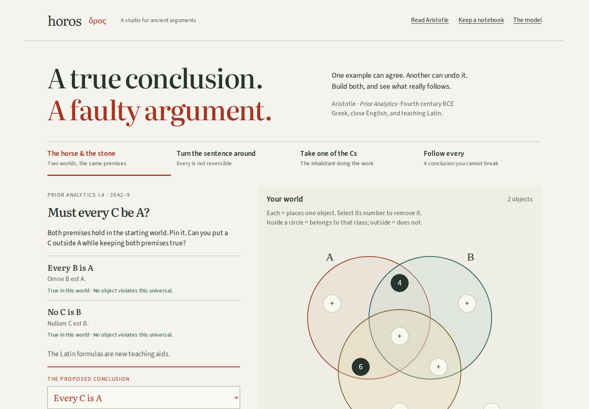

# Horos

**Build two worlds with the same premises. Find the object that breaks the conclusion.**

[](LICENSE)



Every human is an animal. No horse is a human. Every horse is an animal—but
that last statement does not follow from the first two. Substitute stone for
horse: the premise forms survive, while the conclusion changes. Aristotle uses
these terms in _Prior Analytics_ I.4, 26a2–9. Horos makes the counterexample
something a learner constructs, compares, reads, and takes away.

This edition is prepared locally. The intended repository is
`github.com/antonsoo/horos`, with Pages at `antonsoo.github.io/horos/`.
Publication has not been performed; these are not live-demo claims.

## Try it

From this checkout, with Node **24 or later**:

```sh
npm ci
npm run check
npm run dev
```

Open **http://127.0.0.1:4370/horos/**. Place and remove objects with the buttons
in the diagram; a keyboard works throughout. Pin the starting world, then
replace object 6 with object 5. The premises remain true, but “Every C is A”
becomes false. Read the comparison, then inspect Aristotle’s Greek.

The production edition is built and previewed with:

```sh
npm run build
npm run preview
```

Open **http://127.0.0.1:4369/horos/**. The build output is **`dist/`**, using
the base path **`/horos/`**. Development and production use different origins
so an installed offline edition cannot conceal source edits.

## Four investigations

| Investigation            | What the learner changes                        | What it exposes                                  |
| ------------------------ | ----------------------------------------------- | ------------------------------------------------ |
| The horse and the stone  | A C inside A becomes a C outside A              | True premises can survive a false conclusion     |
| Turn the sentence around | Reverse a universal; then weaken it to “some”   | Conversion and its existence assumption          |
| Take one of the Cs       | Remove the shared instance; allow C to be empty | Where the particular conclusion gets its witness |
| Follow every             | Try to place a C outside A                      | Which premise a supposed counterexample breaks   |

An agreeing world, broken premise, missing required inhabitant, empty universe,
and counterexample have different explanations. A pinned world keeps its own
premises, conclusion, and existence settings. If you change the question or its
assumptions, the comparison explicitly stops treating the pair as one experiment.

“Inspect every possible pattern” performs a complete search and lets the learner
put any permitted pattern on the board. The result is accompanied by a
completeness argument, not a claim that a large collection of examples is a proof.
The first screen keeps that answer behind an explicit action.

## Read the argument, not just the answer

Five readings pair Greek with new close English and **20 contextual phrase
notes**. Select _παντὶ τῷ μέσῳ_ to see why “A belongs to every B” means “Every
B is A”; select _ἂν ληφθῇ_ to examine the taking of an instance. The workshop
also supplies new teaching Latin, labeled separately from the historical text.
The Latin for the horse-and-stone passage is an abridgment.

Four complete scanned pages retain Bekker’s printed context and textual notes.
The viewer checks the source bytes, enlarges to the actual image width, and
supports keyboard panning. Selecting another page cancels a pending request;
a late response cannot replace the selected page.

## A notebook that leaves the website

| Artifact               | Contents                                                                                                                                               |
| ---------------------- | ------------------------------------------------------------------------------------------------------------------------------------------------------ |
| Editable JSON          | Both worlds, conclusion kinds, existence requirements, citations, and explanation; outcomes are recomputed                                             |
| Explicit notebook link | The same record in a URL fragment, including the explanation; editing does not rewrite the address bar                                                 |
| SVG                    | Current world, numbered objects, class membership, and an accessible description                                                                       |
| Illustrated HTML       | Both arguments and diagrams, complete search results, all readings and word notes, four complete scans, fonts, licenses, and native JSON/SVG downloads |
| PDF                    | Print the saved HTML; a browser-generated example is retained below                                                                                    |

Save captures the record before asynchronous source work starts. The notebook
verifies the length and SHA-256 of every embedded source, font, and license.
It refuses a substituted file and can be canceled. It has no JavaScript and
makes no asset requests when opened. Learner prose is escaped and preserved,
not automatically graded. There are no accounts, uploads, analytics, or remote
language services.

Actual browser-generated examples:
- [Editable two-world comparison](examples/two-worlds.json)
- [Current world as SVG](examples/two-worlds.svg)
- [Complete illustrated notebook, gzip](examples/two-worlds.html.gz)
- [Printed notebook, PDF](examples/two-worlds.pdf)

To open the retained HTML:

```sh
gzip -dk examples/two-worlds.html.gz
```

Open `examples/two-worlds.html` in a browser. Its “Download editable notebook”
link produces a JSON file that reopens through the workshop’s file control.

## How the model works

An object has three yes/no memberships, so it lies in one of eight regions.
A world is an eight-bit occupancy mask: one representative in each occupied
region. The propositions only ask whether regions are empty; they do not count
objects. Keeping one representative from each occupied region of any larger
world preserves every supported proposition and existence condition.

There are 256 occupancy masks. Excluding the empty universe leaves **255**.
Every possible counterexample in this defined model has a representative in
that search. [The complete argument and historical boundaries](docs/model-and-sources.md)
explain exactly which sentences this covers.

```text
chosen premises + existence requirements
                     |
              place the objects
                     |
         check this particular world
                     |
             pin and change it
                     |
      same premises, changed conclusion?
                     |
             inspect the source
```

`src/core/model.ts` is pure logic. `src/lessons.ts` connects the formal questions
to the source passages. `src/core/record.ts` validates saved records without
trusting supplied outcomes. `src/readings.ts` contains the transcriptions,
translations, and notes. `src/asset-manifest.json` pins the retained bytes.

The production build generates an edition-specific worker from the complete
output inventory. Offline readiness requires a controlling worker, the matching
edition ID, and byte-verified cached files. The development server does not
install a worker. Saving the standalone notebook is a separate offline path.

## Verification

`npm run check` runs formatting/lint checks, strict TypeScript, **11 tests**,
retained-source verification, and a production build. The main independent
oracle turns universal propositions into forbidden regions and existential
propositions into occupancy obligations, then counts worlds by
inclusion–exclusion. It does not call the evaluator or enumerate its worlds.
All **1,536** combinations of three syllogistic figures, four forms in each
position, and eight existence settings agree with the engine’s counts.

With Playwright Chromium and Firefox available:

```sh
npm run test:browser
```

The browser driver operates all four investigations at desktop and 375px,
reads actual displayed source bytes, reopens native downloads, checks keyboard
controls and accessibility, and reloads with the origin refusing connections.
It also injects late and corrupt source responses, changes the live notebook
during export, and cancels preparation. [The review](docs/review.md) records
the observed results and any verification limits.

## Accuracy and limitations

This is a modern finite membership model beside selected passages from ancient
logic. Universal propositions are true when their subject class is empty;
particulars need a witness. Additional existence requirements are explicit.
The empty-class experiment does **not** establish an error in Aristotle or
settle the scholarly interpretation of his existential assumptions.

The app does not decide the truth of claims about the world, cover modal
syllogistic, model relations or identity, or reconstruct Aristotle’s full logic.
The diagrams and representative objects are modern. The source’s use of a
conditional example about pleasure does not endorse its premise. A failed
proposed conclusion does not imply that no other conclusion follows.

Code checks, reproduced browser behavior, source interpretation, clean-build
reproducibility, and publication are separate claims. No independent scholarly
review is claimed. CI and Pages workflows are prepared; no remote execution or
deployment is claimed for this local edition.

## Sources

The primary witness is Immanuel Bekker’s **1831** edition of _Aristotelis opera_,
volume I, [retained at Internet Archive](https://archive.org/details/Bekker1831).
The source selections cover 24b18–20, 25a7–9, 25b37–40, 26a2–9, and 28a23–26.
The [Jenkinson translation](https://classics.mit.edu/Aristotle/prior.1.i.html)
was consulted for comparison; the workshop’s English is new. See the
[source notice](public/sources/NOTICE.txt) and [file manifest](public/sources/manifest.json).

## Contributing and license

See [CONTRIBUTING.md](CONTRIBUTING.md) for the source and browser review process.
Code, diagrams, English, and teaching Latin are [MIT](LICENSE).
Historical Greek and scans are public domain. Literata and Source Sans 3
retain their SIL Open Font Licenses in `public/fonts/`.
