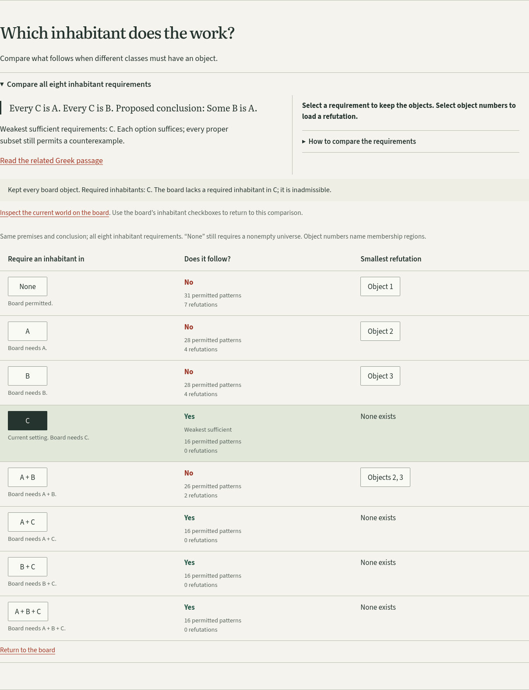

# An inhabitant is an assumption, not a new object

Independent follow-up audit, 2026-11-02. The earlier
[feature review](existence-review.md) records the initial local extension.
This audit reproduced its behavior, re-downloaded the primary images, and
tested cold transfers and an upgrade from the actually published edition.

## Try the actual work

Open [Take one of the Cs](https://antonsoo.github.io/horos/?investigation=inhabitant#existence-map).
Choose **Object 1** in the **None** row, then pin that world. Choose **C** in
the requirement column. The object stays outside all three classes. Under
None it refutes the particular conclusion; under C it is inadmissible.

The comparison explains why C is the weakest sufficient requirement. A and B
do not suffice, even together. Selecting a requirement keeps the world;
selecting a refutation explicitly replaces it. Undo both operations. Read
the related Greek passage, locate the printed instance-taking at 28a22-26,
and save an editable or illustrated notebook with your own explanation.

This is a modern finite model with a nonempty universe and possibly empty
classes. It does not settle Aristotle's treatment of empty terms. Requiring C
does not make this particular inadmissible world a proof. Contradictory premises
cannot count as a sufficient repair. The full answer remains closed on ordinary
visits until requested; the explicit comparison URL opens it.



[Phone capture](assets/existence-audit-phone.png).

## Defects reproduced and repaired

| Observed failure                                                                           | Repair                                                                                                                 | Reproduction evidence                                                                                                                        |
| ------------------------------------------------------------------------------------------ | ---------------------------------------------------------------------------------------------------------------------- | -------------------------------------------------------------------------------------------------------------------------------------------- |
| A cold source and export aborted after 20 seconds while packets continued arriving         | Separate header allowance, body inactivity and total deadline; stream and verify the complete expected bytes           | [Baseline](existence-audit/cold-baseline.json), [Chromium](existence-audit/cold-chromium.json), [Firefox](existence-audit/cold-firefox.json) |
| Long full-cache installation exceeded Firefox's worker-event lifetime                      | Install the small bootstrap; let the open page retain large files; report ready only after a complete worker inventory | Same cold-load receipts; [offline upgrade](existence-audit/upgrade.json)                                                                     |
| A conditional notebook link changed the same tab's address without changing its experiment | Parse hash navigation, retain undo, and invalidate older pending imports even for an identical shared record           | [Baseline](existence-audit/links-baseline.json), [four repaired journeys](existence-audit/links.json)                                        |
| The extension revealed the full answer on the way to the learner's pinned worlds           | Use the existing native disclosure and explicit board links; keep disclosure outside notebook state                    | [Desktop/phone journeys](existence-audit/existence.json)                                                                                     |
| Failed background cache repair could announce its own failure repeatedly                   | Stop self-triggered repair notifications; retain an honest incomplete status and recover on a real retry               | [Cache-damage and two-tab audit](existence-audit/readiness.json)                                                                             |

The Firefox lifetime issue was distinct from the source timeout: removing the
20-second timeout allowed source reading and export, while a full installation
still failed around a minute. Mozilla's
[worker-lifetime discussion](https://bugzilla.mozilla.org/show_bug.cgi?id=2086212)
also documents the finite event allowance. The repaired design does not depend
on keeping an installation event alive for the entire source bundle.

## Retention and cancellation

`src/verified-transfer.ts` supplies the same streaming verifier to the page
and generated worker. A request has a **60-second header allowance**, a
**15-second body-inactivity limit**, and a **180-second total deadline**.
Surplus bytes cancel the reader immediately. Truncated or wrong-hash bytes
cannot become a displayed source or notebook attachment. Cancellation releases
pending reads, and retry preserves the learner's work.

The page owns large retention transfers. A per-edition, per-URL Web Lock
coordinates source viewing, export, background retention and other tabs.
Canceling a waiting request does not cancel another page's independent request.
The worker bypasses those page-owned requests and verifies its cache inventory
without performing long network work inside an inventory event.

Updates may copy old cached files only after checking them against the new
edition's byte count and SHA-256. Installation does not discard a healthy old
edition when the new cache is partial. Old caches are pruned only after the new
inventory is complete. Saving an editable notebook before closing remains
necessary: in-memory history is not an automatic disk backup.

## What was operated

All final browser matrices used edition `f69295e424511b7f8a0c`, Chromium
153.0.8010.12 and Firefox 155.0. These are local observations, not CI claims.

| Exercise                                                                                                  | Observed result and retained receipt                                                                                                                                                                                    |
| --------------------------------------------------------------------------------------------------------- | ----------------------------------------------------------------------------------------------------------------------------------------------------------------------------------------------------------------------- |
| Existing class investigations and sources, desktop and 375px                                              | [Four journeys and fault checks](existence-audit/classes.json)                                                                                                                                                          |
| Requirement comparison, keyboard, native JSON, shared links and source locator                            | [Four journeys](existence-audit/existence.json); no automated accessibility violations in the reviewed live/saved views                                                                                                 |
| Conditional facts, table assumptions, six readings and native downloads                                   | [Four journeys and fault checks](existence-audit/conditionals.json)                                                                                                                                                     |
| Standalone readings at 320px and 375px                                                                    | [Both rooms and engines](existence-audit/portable.json); no HTTP asset requests, escaped hostile prose, native editable downloads                                                                                       |
| Cold first visit at a shared 128,000 bytes/second across page and worker traffic                          | [Chromium](existence-audit/cold-chromium.json), [Firefox](existence-audit/cold-firefox.json); active bodies longer than 20 seconds succeed, then origin-stopped offline reopening and byte-identical illustrated export |
| Actual body stalls, delayed headers, oversized/truncated responses, canceled reads and successful retries | [Chromium](existence-audit/faults-chromium.json), [Firefox](existence-audit/faults-firefox.json); includes page-owned and ordinary worker image requests                                                                |
| Continuous trickle that never reaches the inactivity limit                                                | [Chromium deadline exercise](existence-audit/deadline.json); partial response refused after about 180 seconds, note retained, retry succeeds                                                                            |
| Source eviction/corruption, cross-tab withdrawal, recovery and waiting editions                           | [Readiness audit](existence-audit/readiness.json); no synthetic inventory-success messages                                                                                                                              |
| Upgrade from published gh-pages `f06a049`                                                                 | [Both engines](existence-audit/upgrade.json); all six scans carried forward by digest, network closed before old tabs, new edition activates offline and reopens the saved old notebook                                 |

The cold fixture snapshots the production build into memory and schedules
4,096-byte packets across a shared link. The fault fixture really stops sending
bytes or headers; these observations are not a timer-only mock. Local offline
journeys stop the server and disable browser networking.

Reproduce from a built checkout with Playwright Chromium and Firefox available:

```sh
npm run check
npm run verify:existence
npm run test:browser
npm run test:existence
npm run test:conditionals
npm run test:portable
npm run test:notebook-links
npm run test:readiness
npm run test:cold-transfer
npm run test:transfer-faults
npm run test:transfer-deadline
```

`node scripts/upgrade-carryover-review.mjs <previous-build-directory>` exercises
offline activation against a retained previous build. A fresh archive of
`0f4a0f5`, installed under Node 24.22.1, passed check and the independent oracle.
All **25** generated files match the Node 26.7.0 working build byte for byte:
[clean-build inventory](existence-audit/clean-build.json). Build with
`npm run build`; output is `dist/`, base `/horos/`.

## Source reinspection and limits

All six primary JPEGs were independently fetched again from their original
Archive page-service URLs, compared with the retained images, and visually
inspected: [HTTP identities](existence-audit/primary-sources.json). The witness
remains Bekker 1831, printed pages 24, 25, 26 and 28, and Mutschmann 1912,
printed pages 92 and 93. No transcription correction was found in this pass.
This is direct inspection, not independent scholarly certification.

The set-based Python oracle independently agrees with all **128** requirement
settings, including counts, smallest witnesses and minimal sufficient settings.
It checks the modern semantics, not the historical interpretation. The ordinary
core checks cover 1,536 syllogistic settings and 72 legal conditional drafts.

The refreshed conditional reading contains the current license and source notice,
with a 22-page tagged Chromium PDF. Both complete scan pages remain intact with
their captions. The earlier MIT artifacts remain in their original Git history.
Physical printing, assistive-technology user testing and historical scholarly
review are not claimed.

## Publication boundary

The final candidate is locally verified. Public byte comparison, hosted browser
journeys, remote source synchronization and CI execution will be recorded
separately after publication. None follows merely from this local matrix.
