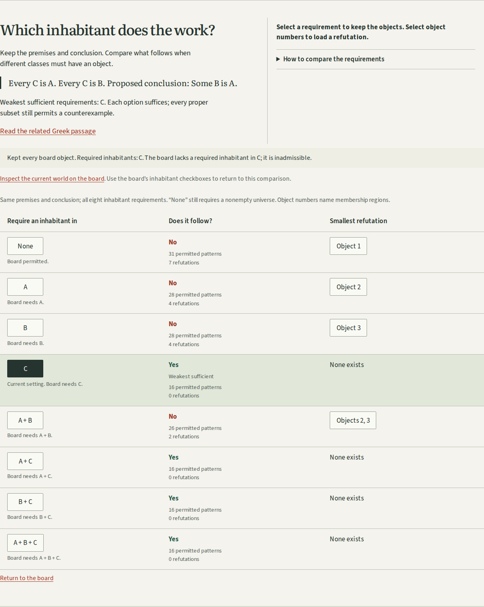
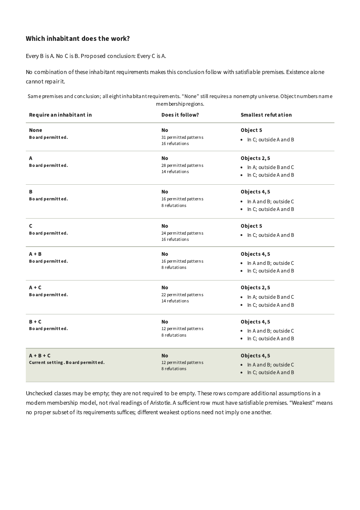

# Which inhabitant does the work?

Horos now compares every inhabitant requirement for the argument the learner is
already operating. At the starting source commit `3311b14`, the workshop checked
only one selected setting at a time. I reproduced the conversion exercise with
B required and optional: its particular conclusion changed from following to
not following, but there was no view of the other settings or of which extra
requirements were unnecessary.

The addition identifies every inclusion-minimal sufficient setting, gives a
smallest refutation under every failing setting, and lets the learner keep a
world fixed while its admissibility changes. It extends the four existing
investigations; it adds no room, repository, dependency or historical text.

## Operate the actual question

Build with `npm run build`, then use `npm run preview`. Open
`http://127.0.0.1:4369/horos/?investigation=inhabitant#existence-map`.

The premises are Every C is A and Every C is B; the proposed conclusion is Some
B is A. The exact counts below are independently checked occupancy patterns,
not probabilities or numbers of real inhabitants.

| Required classes | Permitted patterns | Refutations | Does the conclusion follow? |
| ---------------- | -----------------: | ----------: | --------------------------- |
| None             |                 31 |           7 | No                          |
| A                |                 28 |           4 | No                          |
| B                |                 28 |           4 | No                          |
| C                |                 16 |           0 | Yes; weakest sufficient     |
| A + B            |                 26 |           2 | No                          |
| A + C            |                 16 |           0 | Yes                         |
| B + C            |                 16 |           0 | Yes                         |
| A + B + C        |                 16 |           0 | Yes                         |
1. Select **Object 1** in the None row. It places one representative outside all
   three classes and removes all named-class existence requirements. Both
   universal premises hold and the particular conclusion is false.
2. Pin this world, then select **C** in the first column. Every object stays
   exactly where it was. The world now lacks a required C, so it is inadmissible.
   It has not become an example proving the conclusion.
3. Use **Inspect the current world on the board**, then the board's comparison
   link to return. Undo and redo restore the corresponding world and requirements.
   Keyboard focus stays on the selected table control when the table updates.
4. Read the related Greek passage and use **Locate passage**. The complete
   printed page remains available beside the excerpt and word notes.
5. Write an explanation and save the illustrated notebook. Both snapshots retain
   their own complete comparisons, including the object memberships behind each
   refutation. The JSON record and explicit shared link preserve their inputs.

[Actual editable example](../examples/existence.json) uses that sequence.
The existing [illustrated horse-and-stone example](../examples/two-worlds.html.gz)
and [tagged PDF](../examples/two-worlds.pdf) were regenerated through the actual
native download flow; both now include the comparison for each snapshot.
Decompress the HTML before opening it.



[Phone screenshot](assets/existence-phone.png) shows all three columns without
horizontal page overflow. The longer instructions use a disclosure so they do
not dominate the comparison. The existing reading type, diagram colors and
quiet controls remain consistent with the rest of the workshop.



## Source and modern model

I directly inspected the complete retained Bekker page 28. The passage at
28a22-26 describes taking one of the Ss as an instance. The board's A, B, C
rename the printed Π, Ρ, Σ; Ν is the instance. The existing Greek, close English,
teaching Latin and editorial warning remain unchanged. I also checked the
[Jenkinson translation, Book I, parts 2, 4 and 6](https://classics.mit.edu/Aristotle/prior.1.i.html).

The reviewed printed page is from Bekker's 1831 edition, not an ancient
manuscript. Its retained SHA-256 is:

```text
sources/bekker-p28.jpg
a93760f9e0f3bc05114cc6e50e2e6dbd6b04d325baba2241cf0f2bd6801f4c9b
```

This comparison is explicitly modern. Universals permit an empty subject class;
particulars demand a witness. An unchecked class may be empty, but need not be.
The universe itself must contain an object. The feature does not claim Aristotle
accepts these empty-class counterexamples against his own inferences, and it
does not resolve the historical debate about existential import.

A sufficient row must have satisfiable premises. Inclusion-minimal means no
proper subset is sufficient; all incomparable minimal options are retained.
Smallest refutations minimize occupied regions, with deterministic mask order
breaking ties. The completeness argument already justifies one representative
per occupied region. See [the model](model-and-sources.md#weakest-inhabitant-requirements).

## Verification

Source implementation: `b89dc0d` and its two preceding feature commits. Build
command: `npm run build`; output: `dist/`; base path: `/horos/`.

```sh
npm ci
npm run check
npm run verify:existence
npm run test:existence
REVIEW_OUTPUT=test-results/existing-browser npm run test:browser
npm run test:portable
```

- Clean installation and check passed: lint, strict typecheck, 21 substantive
  tests, both source/font/license inventories, and production build.
- The independent Python set-based oracle checked 128 settings. It verified
  truth, every count, witness membership and minimum cardinality, every minimal
  sufficient option, and preservation of the absence of refutations when adding
  requirements. Additional unit cases cover incomparable sufficient options and
  unsatisfiable requirements.
- New learner journeys passed in Chromium and Firefox at 1440px and 375px. They
  operate all four lessons, preserve the world through changed requirements,
  load refutations, undo/redo, locate the Greek, reopen JSON and links, and use
  native illustrated downloads. Both the live and saved readings have zero axe
  violations in these checks. This is automated accessibility evidence, not a
  complete accessibility certification.
- Each new journey stops its actual local origin and disables browser networking,
  reloads the controlled offline edition, reopens the notebook and exports
  byte-identical illustrated HTML. The standalone reading makes no HTTP requests,
  has no scripts, and fits 320px as well as the tested workshop width.
- The existing four browser journeys and both fault suites passed. Those checks
  include retained-image identities, all passage locators, late source replies,
  newer edits during import, corrupt source/export refusal, frozen export inputs,
  cancellation, cache-damage readiness withdrawal and recovery.
- Both rooms' portable readings passed the separate Chromium/Firefox 320px and
  375px review, including long hostile prose, native editable downloads, complete
  embedded sources and keyboard-scrollable tables.
- I inspected the new desktop/phone screenshots, existing-journey contact sheets,
  and a rendered PDF comparison page. The new print table starts with its heading
  and keeps all eight rows together on one A4 page. An early regression run
  found duplicate landmark names in the two saved comparisons; each is now
  explicitly named for its snapshot.

The documented `npm run dev` and `npm run preview` commands were also started
on their advertised ports, and the refutation-to-inadmissible sequence was
operated in Chromium on both servers.

A fresh archive of `b89dc0d` was installed and checked separately under Node
24.22.1. All 25 produced files, including the service worker, are byte-identical
to the working build made under Node 26.7.0. The
[clean-build inventory](existence-review/clean-build.json) records each hash.

Receipts: [new journeys](existence-review/journeys.json),
[existing journeys and fault suites](existence-review/existing-browser.json),
[portable readings](existence-review/portable.json). These identify actual runs;
they do not assert that a remote workflow or public deployment ran.

## Publication boundary and limits

The extension is committed locally. No push, tag, deployment, repository creation
or remote workflow was requested or performed. The public site and Officina entry
have not been asserted to contain these changes. House standards reserve
publication for explicit authorization. The source/model distinction remains a
limitation of the teaching experiment, rather than a defect hidden by a verdict.

Suggested repository description:

> Build Aristotle's counterexamples, compare existence assumptions, and read the Greek beside the printed evidence.

Topics: `aristotle`, `ancient-greek`, `logic`, `education`, `visualization`,
`offline-first`, `typescript`.
